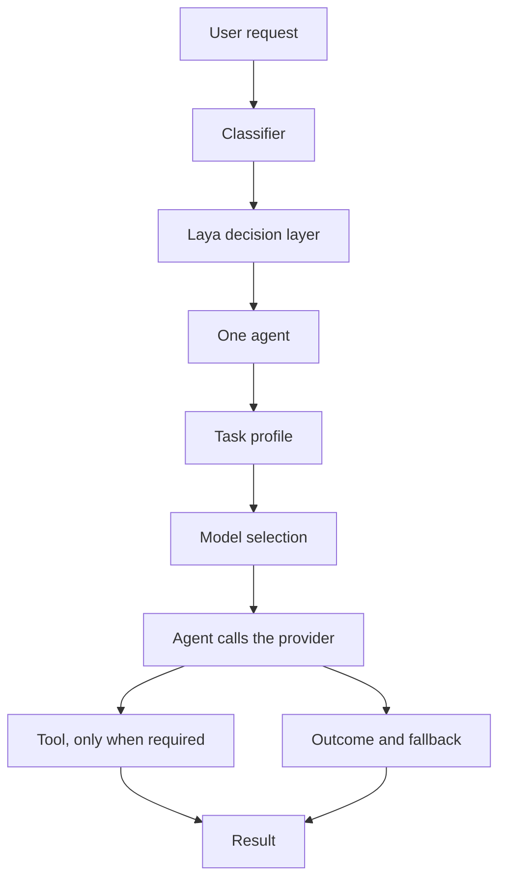

# AgentRoute

AgentRoute is an open-source routing platform. A request does not go straight to a model. A decision layer chooses an agent, the task is profiled, a model is selected for that agent, and a tool runs only when that agent needs one.

```
User
  → Laya (decision layer)
  → agent
  → task requirements
  → model selection
  → selected agent
  → tools, when required
  → execution
  → evaluation
  → retry or fallback
  → result
```

Laya is the decision layer. It is not a model, an agent, a provider, or a tool. It chooses which agent should handle the request. The model selector then chooses which model that agent should call.

## System architecture

Open [`docs/architecture.html`](docs/architecture.html) in a browser to watch one request travel the path. On screen, a marker moves down the layers and the caption names the stage that is active.



The router in `agentroute/router.py` is the same sequence:

1. **User request.** Text arrives at the API (`POST /api/chat`) or at `demo.py`.
2. **Classifier.** A baseline reading of intent, complexity, and confidence.
3. **Decision layer.** `DECISION_LAYER` picks the policy: `laya`, `baseline`, or `adaptive`. Laya may replace the classifier’s intent and complexity with its own answers.
4. **Agent.** Exactly one of the six agents. A live browser request with the Playwright plugin on is handed to `WEB_AGENT`, because that agent owns `PLAYWRIGHT_TOOL`.
5. **Task profile.** Capability, complexity, context, the operation on stored work, and whether a tool is required.
6. **Model selection.** `MODEL_SELECTION=efficient` picks the lightest model that meets the task. `pinned` keeps the configured model when it is sufficient.
7. **Execution.** The agent calls the provider. The router never calls Gemini, NVIDIA, Groq, or OpenRouter itself.
8. **Tools.** Blender, Playwright, or web search run only inside the agent that owns them.
9. **Evaluation and fallback.** The outcome is scored and stored. If the primary model fails, the fallback model stays inside the same agent.
10. **Result.** The answer and the routing record return to the client. A successful Blender scene is published by id. A Playwright page stays open for a later turn in that same conversation.

Conversation state keeps each task branch separate. A coding follow-up, a 3D follow-up, and a browser follow-up do not share one subject. A browser page belongs to the conversation that opened it.

## Agents

| Agent | What it handles |
| --- | --- |
| `GENERAL_AGENT` | Everyday requests that do not belong to a specialist |
| `CODING_AGENT` | Writing and changing code |
| `REASONING_AGENT` | Multi-step reasoning |
| `RESEARCH_AGENT` | Research that can use web search |
| `THREE_D_AGENT` | 3D scene work. It owns `BLENDER_TOOL` |
| `WEB_AGENT` | Live browser work. It owns `PLAYWRIGHT_TOOL` |

There is no Blender agent and no Playwright agent. Blender and Playwright are tools.

## Tools

| Tool | Owner |
| --- | --- |
| `BLENDER_TOOL` | `THREE_D_AGENT` |
| `PLAYWRIGHT_TOOL` | `WEB_AGENT` |
| `WEB_SEARCH_TOOL` | `RESEARCH_AGENT` |
| `CODE_EXECUTION_TOOL` | Declared only. It is not implemented |
| `FILESYSTEM_TOOL` | Declared only. It is not implemented |
| `GITHUB_TOOL` | Declared only. It is not implemented |

In the app, Blender and Playwright start off. Turn a plugin on in the left sidebar before asking for that kind of work. With Playwright off, a browser task stops with: “Playwright is disabled. Enable the Playwright plugin to execute this browser task.” With Blender off, a 3D task stops with: “Blender is disabled. Enable the Blender plugin to execute this 3D task.”

## Model providers

Agents call models through these providers. You supply your own keys. This repository does not include any keys.

| Provider | Key variable | Where to create a key |
| --- | --- | --- |
| Gemini | `GEMINI_API_KEY` | https://aistudio.google.com/apikey |
| NVIDIA NIM | `NVIDIA_API_KEY` | https://build.nvidia.com/ |
| Groq | `GROQ_API_KEY` | https://console.groq.com/keys |
| OpenRouter | `OPENROUTER_API_KEY` | https://openrouter.ai/keys |

The default provider is Gemini (`AGENTROUTE_PROVIDER=gemini`). Models that this project treats as verified for display are:

- Gemini: `gemini-flash-latest`, `gemini-flash-lite-latest`
- NVIDIA: `nvidia/nemotron-3-ultra-550b-a55b`, `nvidia/nemotron-3-super-120b-a12b`, `nvidia/nemotron-3.5-lightning-30b-a3b`
- Groq: `openai/gpt-oss-20b`, `openai/gpt-oss-120b`, `qwen/qwen3.8-27b`

A key only unlocks the models that account can call. If a model id 404s, change the model name in `agentroute/.env`. Do not hardcode a different id in Python.

### Where the models live

The chat models stay on the provider. AgentRoute sends the prompt to that provider’s API with your key. This repository does not contain model weights, and there is no local download step for Gemini, NVIDIA, Groq, or OpenRouter.

| Provider | Endpoint the agent calls | What you install |
| --- | --- | --- |
| Gemini | `https://generativelanguage.googleapis.com/v1beta/openai/` | A `GEMINI_API_KEY` |
| NVIDIA NIM | `https://integrate.api.nvidia.com/v1` | An `NVIDIA_API_KEY` from https://build.nvidia.com/ |
| Groq | `https://api.groq.com/openai/v1` | A `GROQ_API_KEY` |
| OpenRouter | `https://openrouter.ai/api/v1` | An `OPENROUTER_API_KEY` |

Set `AGENTROUTE_PROVIDER` to the provider you want as the default (`gemini`, `nvidia`, `groq`, or `openrouter`). The selector can still choose a model on another provider when that provider’s key is present.

### Registry

`availability` in `agentroute/model_registry.py` means:

- **verified** — a real chat completion succeeded during development
- **listed** — the provider lists the id; a given account can still receive a 404

Verified models:

| Provider | Model id | Tier |
| --- | --- | --- |
| Gemini | `gemini-flash-latest` | balanced |
| Gemini | `gemini-flash-lite-latest` | light |
| NVIDIA | `nvidia/nemotron-3-ultra-550b-a55b` | strong |
| NVIDIA | `nvidia/nemotron-3-super-120b-a12b` | balanced |
| NVIDIA | `nvidia/nemotron-3.5-lightning-30b-a3b` | light |
| Groq | `openai/gpt-oss-20b` | light |
| Groq | `qwen/qwen3.8-27b` | balanced |
| Groq | `openai/gpt-oss-120b` | strong |

Also registered, listed rather than verified for every account: `gemini-2.5-pro`, `gemini-2.5-flash`, `gemini-2.5-flash-lite`, `gemini-2.0-flash`, `nvidia/nemotron-nano-3-30b-a3b`, `mistralai/codestral-22b-instruct-v0.1`, `deepseek-ai/deepseek-coder-6.7b-instruct`.

OpenRouter ids are configured per role in `agentroute/.env` (`OPENROUTER_CODING_MODEL` and the other `OPENROUTER_*_MODEL` lines). They are not a second copy of the table above.

To see which free OpenRouter models are listed right now, from `agentroute/` with the virtualenv active:

```powershell
python model_discovery.py
python model_discovery.py --all
```

That command only reports. It does not write `.env` and it does not download weights.

### Make a provider usable

1. Create a key at the link in the table above.
2. Paste it into `agentroute/.env`. Leave unused providers blank.
3. Start the API again so it reloads the file.

One Gemini key is enough to run the default path. Add NVIDIA, Groq, or OpenRouter when you want the selector to use those catalogs too.

## Download Laya

Laya is the only model this project downloads onto the machine. The package is on PyPI. The checkpoint is the Hugging Face repo `convaiinnovations/laya`.

`pip install -r agentroute\requirements.txt` already installs `laya`, PyTorch, and `transformers`. That install is large. Python 3.12 is the safer interpreter for this stack. Python 3.14 can run the API; use 3.12 if the Laya install fails on 3.14.

Download the checkpoint before the first chat, with the virtualenv active:

```powershell
$env:LAYA_PRELOAD = "true"
python -c "from laya import Router; Router(preload=True); print('laya checkpoint ready')"
```

```bash
LAYA_PRELOAD=true python -c "from laya import Router; Router(preload=True); print('laya checkpoint ready')"
```

The files land in the Hugging Face cache for that user account (usually `~/.cache/huggingface` on macOS and Linux, and `%USERPROFILE%\.cache\huggingface` on Windows). Later runs reuse the cache.

To download it when the API process starts, instead of on the first request, set this in `agentroute/.env`:

```
DECISION_LAYER=laya
LAYA_CHECKPOINT=convaiinnovations/laya
LAYA_PRELOAD=true
```

`LAYA_CHECKPOINT` can point at another Hugging Face repo id if you are testing a different Laya build. The default is the official one.

Skip the download entirely with:

```
DECISION_LAYER=baseline
```

Baseline routing still picks an agent from the classifier. It does not claim to be Laya. If Laya is selected but the package or the checkpoint fails at runtime, the router falls back and labels that decision as a fallback.

Package page: https://pypi.org/project/laya/
Checkpoint card: https://huggingface.co/convaiinnovations/laya

## What you need

- Python 3.12 or newer (3.14 works on Windows for the API; 3.12 is the safer choice if you install the Laya/PyTorch stack)
- Node.js 20 or newer
- A Gemini key at minimum, if you keep the default provider
- Optional: [Blender](https://www.blender.org/download/) on this machine for “View in Blender”
- Optional: Playwright’s Chromium, installed by the setup steps below, for live browser tasks

The Laya package and checkpoint are covered in [Download Laya](#download-laya). Set `DECISION_LAYER=baseline` when you want to skip that download.

## Setup

From the repository root:

### 1. Python environment and dependencies

```powershell
python -m venv .venv
.\.venv\Scripts\Activate.ps1
pip install -r agentroute\requirements.txt
pip install -r backend\requirements.txt
python -m playwright install chromium
```

On macOS or Linux, activate with `source .venv/bin/activate` and use forward slashes in the `pip` paths.

### 2. Your API keys

```powershell
copy agentroute\.env.example agentroute\.env
copy frontend\.env.example frontend\.env
```

Open `agentroute/.env` and paste your own keys. Leave unused providers blank.

```
GEMINI_API_KEY=your-gemini-key
NVIDIA_API_KEY=your-nvidia-key
GROQ_API_KEY=your-groq-key
OPENROUTER_API_KEY=
AGENTROUTE_PROVIDER=gemini
DECISION_LAYER=laya
```

`agentroute/.env` and `frontend/.env` are gitignored. Never commit them.

The full list of model, provider, and tool settings is in [`agentroute/.env.example`](agentroute/.env.example).

### 3. Frontend

```powershell
cd frontend
npm install
```

`frontend/.env` should point at the API:

```
VITE_API_URL=http://127.0.0.1:8010
```

### 4. Run it

API, from the repository root, in one terminal:

```powershell
.\.venv\Scripts\Activate.ps1
python -m uvicorn main:app --app-dir backend --host 127.0.0.1 --port 8010
```

UI, in a second terminal:

```powershell
cd frontend
npm run dev
```

Vite serves the UI at http://127.0.0.1:5173. The API health check is http://127.0.0.1:8010/api/health.

If port 5173 is already taken, Vite is configured with `strictPort` and will exit. Free that port, or change `server.port` in `frontend/vite.config.ts` and add the new origin to `CORS_ORIGINS` (see below).

Open the UI, choose **Launch AgentRoute**, and send a message. Refreshing the page returns to the landing page. Plugin toggles are not saved across refreshes.

## Browser and Blender

**Playwright.** With the Playwright plugin on, a request that names a live `http` or `https` page and asks to open, scrape, click, or screenshot it is handled by `WEB_AGENT`. Chromium opens in a visible window. Set this when you want headless mode (CI, a server with no display):

```
AGENTROUTE_PLAYWRIGHT_HEADLESS=1
```

**Blender.** Install Blender and either put `blender` on your `PATH` or set `BLENDER_PATH` to the executable. On Windows that is often:

```
BLENDER_PATH=C:\Program Files\Blender Foundation\Blender 5.2\blender.exe
```

Turn the Blender plugin on in the sidebar, then ask for a 3D scene. “View in Blender” opens the `.blend` file that the tool wrote on this machine. That path is local. It is not something a hosted website can open.

**Web search.** `SEARCH_API_KEY` in `agentroute/.env` is reserved for `WEB_SEARCH_TOOL`. Leave it blank until you connect a search backend.

## API access from another origin

The API allows these browser origins by default:

- `http://localhost:5173`
- `http://127.0.0.1:5173`
- `http://localhost:5174`
- `http://127.0.0.1:5174`

To allow another frontend origin, set `CORS_ORIGINS` in the environment before starting the API (comma-separated). The frontend build must use the same API address in `VITE_API_URL`. A static frontend deployed on the public internet cannot call `http://127.0.0.1:8010` from someone else’s browser. For that, run the API on a reachable host and set both values to that public API URL.

## Project layout

| Path | Role |
| --- | --- |
| `agentroute/` | Routing, agents, tools, model registry, provider clients |
| `backend/` | FastAPI app. Each chat request calls the router |
| `frontend/` | React + Vite UI: landing page, chat, plugin sidebar, routing inspector |
| `docs/architecture.html` | Animated view of the same routing path |

## Tests

From the repository root, with the virtualenv active and `DECISION_LAYER` left as you configured it:

```powershell
cd agentroute
python -m pytest
```

Frontend typecheck, from `frontend/`:

```powershell
npx tsc -b
```

## Design boundaries

Prompt-injection handling and human approval are design boundaries of the router. They are not a separate security product, and this repository does not ship one.

Context continuity matches a follow-up to the current task, a new task, or a previous task from the conversation itself. It does not use a list of domain keywords.

## License

MIT. See [LICENSE](LICENSE).
